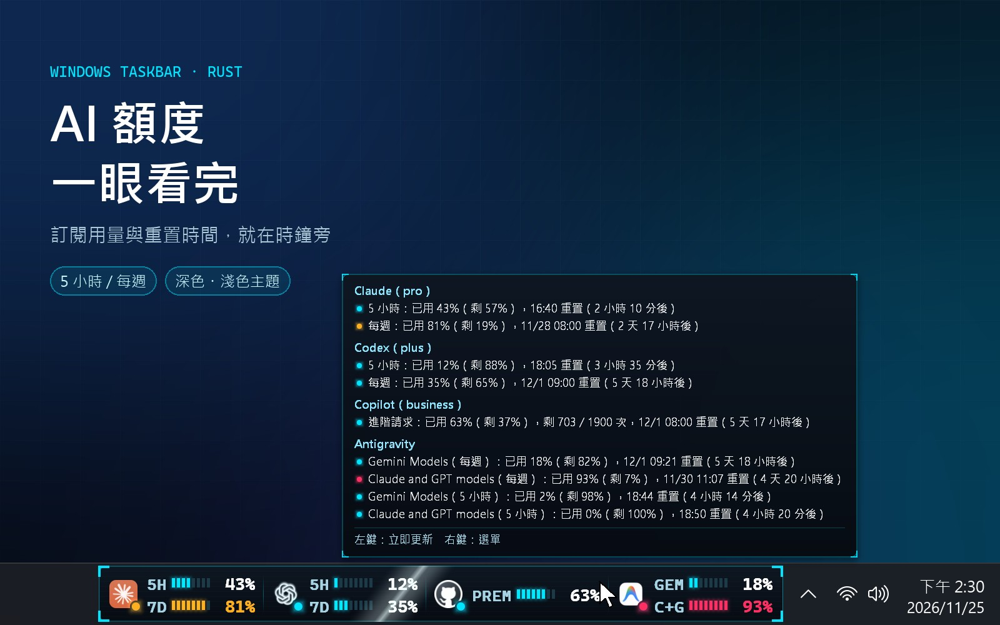

# AI Quota Bar

在 Windows 工作列時鐘旁，一眼看到各家 AI 訂閱還剩多少額度。



HUD 風格面板：邊框與四角括號、LED 分段進度條、等寬數字。每家用自己 App 的圖示代表，右下角的狀態燈依最緊的額度變色。主題可選深色（霓虹青）、淺色（白底），預設跟隨系統的工作列顏色。每次查到新資料時，會有一道光澤從左掃到右。

- 支援 **Claude**（5 小時、每週）、**Codex**（依方案的 5 小時／每週／30 天）、**GitHub Copilot**（每月聊天、補全、進階請求）、**Antigravity**（Gemini 與 Claude/GPT 兩組，可選顯示 5 小時、每週或較緊的那個）。
- 直接讀各工具已經存好的登入資料，不用另外輸入帳號密碼或 API key。唯一會寫回的是 Claude 的登入檔（見下方「Claude 登入自動更新」），其他家只讀不寫。
- 單一 EXE（約 430 KB），沒有任何遙測，資料只送往各家官方伺服器。
- 預設顯示「已用」百分比；右鍵選單勾「顯示剩餘百分比」可改成跟 Antigravity、Claude 網頁一樣顯示「還剩多少」，進度條也跟著改成剩餘量。
- 每組有多個額度時（例如 Antigravity 的 5 小時與每週），工作列預設只顯示最緊的那個，滑鼠移上去可看全部。Antigravity 可在右鍵選單「Antigravity 顯示」固定顯示 5 小時或每週。
- 用量 75% 以上變琥珀色、90% 以上變紅（顯示剩餘時也是依已用程度變色）；資料過期時圖示轉灰、整塊淡化。
- 圖示在執行時從本機已安裝的 App 讀取（Claude、Codex、GitHub Copilot、Antigravity 桌面版），程式本身不帶任何商標圖檔；找不到 App 時改顯示名稱文字。

## 使用方式

| 操作 | 效果 |
| --- | --- |
| 滑鼠移到上面 | 顯示每一個額度的詳細用量與重置時間 |
| 左鍵 | 立即更新 |
| 右鍵 | 選單：立即更新、顯示／隱藏各家、Copilot 帳號、Antigravity 顯示（較緊的／5 小時／每週）、顯示在哪個螢幕、顯示剩餘百分比、主題（跟隨系統／深色／淺色）、隱藏工作列小工具、開啟 Claude 用量頁面、開機時自動啟動、結束 |
| 系統匣圖示：左鍵 | 顯示／隱藏整個工作列小工具（隱藏後從這裡叫回來） |
| 系統匣圖示：右鍵 | 同一份選單 |

自動更新間隔：Claude 每 5 分鐘（它的用量 API 限流較嚴，Claude Code 自己也會查）；Codex、Copilot 每 2 分鐘；Antigravity 每 10 分鐘（每次要啟動 CLI）。

伺服器回「查詢太頻繁」（HTTP 429）時會自動放慢：等待時間每次加倍，最長 30 分鐘，期間點左鍵也不會再查；滑鼠提示會顯示下次自動重試的時間，數字淡化顯示上次的結果。

## 各家需要的登入

| 服務 | 讀取來源 | 沒有的話 |
| --- | --- | --- |
| Claude | `%USERPROFILE%\.claude\.credentials.json`（Claude Code 登入訂閱帳號） | 執行 `claude` 登入 |
| Codex | `%USERPROFILE%\.codex\auth.json`（Codex 用 ChatGPT 帳號登入） | 執行 `codex` 登入 |
| Copilot | `gh auth token`（GitHub CLI）；gh 登入多個帳號時，右鍵選單「Copilot 帳號」可選要顯示哪一個（例如個人或公司） | 執行 `gh auth login` |
| Antigravity | `%LOCALAPPDATA%\agy\bin\agy.exe -p /usage` | 安裝並登入 Antigravity CLI |

找不到登入資料的那家不會出現在工作列上。

## Claude 登入自動更新

Claude 的登入憑證約 8 小時就過期。快到期（剩 5 分鐘內）或被伺服器拒絕時，本程式會照 Claude Code 自己的流程換新 token 並寫回 `.credentials.json`，所以不開 Claude Code 數字也會持續更新：

- 先取得 Claude Code 用的同一組目錄鎖（`.claude\.oauth_refresh.lock` 與 `.claude.lock`）；Claude Code 正在換就不動，下次再試。
- 在鎖內重新讀檔，別人剛換過就直接沿用，不重複換。
- 只改 `claudeAiOauth` 裡的 token、到期時間與 scope，其他內容（MCP 登入等）原樣保留；先寫暫存檔再整個取代，失敗會重試，仍失敗就保留暫存檔。
- 換 token 被拒（refresh token 失效）時不動檔案，提示執行 `claude` 重新登入。
- 結束程式或登出時，會等進行中的更新做完。

## 已知限制

- 用的都是各家**非官方**的內部 API，廠商一改就可能失效。
- 查不到新資料時，數字會淡化；已過重置時間的數字改顯示「–」。
- Antigravity：若 CLI 沒把 `/usage` 當指令處理（會變成一般提問、消耗額度），程式會立刻停用 Antigravity，重開程式才會再試。
- 多螢幕時可從右鍵選單「顯示在」選擇掛在哪個螢幕的工作列（需開啟 Windows「在所有顯示器上顯示工作列」）；選的螢幕拔掉時自動回到主螢幕。副螢幕工作列沒有系統匣，會保留右側約 130 px 給時鐘，並避開其他已嵌在工作列上的小工具。
- Windows 11 會把新的系統匣圖示收進「^」裡，想常駐顯示請到「設定 → 個人化 → 工作列 → 其他系統匣圖示」打開 ai-quota-bar。
- Windows 11 沒有正式的工作列小工具 API，這裡是把視窗嵌進工作列，Windows 大改版後可能需要調整。

## 開發

```powershell
cargo test
cargo build --release
.\target\release\ai-quota-bar.exe --dump quota.txt   # 查一次，把提示文字寫到檔案
```

`fixtures/` 是實際 API 回應（已去除帳號資訊），給解析測試用。

## 授權

[MIT](LICENSE)。Claude、Codex／OpenAI、GitHub Copilot、Antigravity 是各自公司的商標，本專案與它們無關，也未獲背書；圖示是執行時從使用者已安裝的 App 讀取，不隨程式散布。
